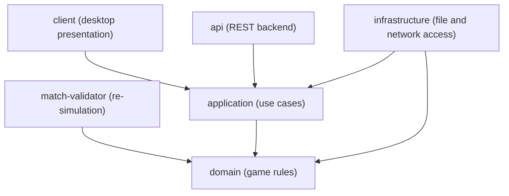
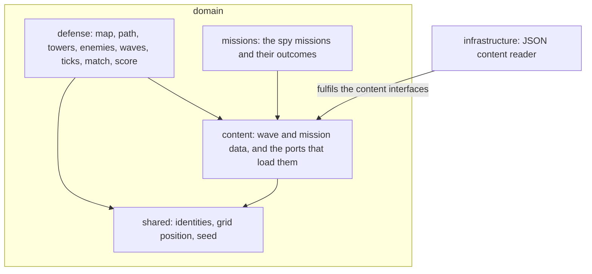

# Architecture

Hedgehog Firewall keeps its game rules in a pure core and treats everything around
them, the screen, the files, the network, as replaceable edges. The rules run the
same way inside the desktop client and inside the server that re-checks a finished
match, which is what lets the server trust a score. See the decision records in
`adr/` for why the backend is one deployable unit and why the rules sit at the
centre.

## Modules

Dependencies point inward: the client and the backend depend on the use cases,
the use cases depend on the rules, and the module that reads files or talks over
the network depends inward on the rules through interfaces the rules own.

## Contexts

The rules module is split into focused areas. Shared value objects (identities,
grid position, seed) sit in a common area the others build on. Content (waves and
missions as data) is described by interfaces the rules own; the file reader that
fulfils them lives in the infrastructure module.

## A match

A match is a seed, a set of waves and a list of player commands. Playing those
same three things again produces the same result tick for tick, which is how the
server validates a score. Each tick, due commands apply, the current wave releases
enemies, towers act, enemies advance, and enemies that are stopped or that reach
the central node are settled. Between waves there is build time, and after the
second and fifth waves a short spy mission is offered. When the central node's
integrity reaches zero the match is lost.
